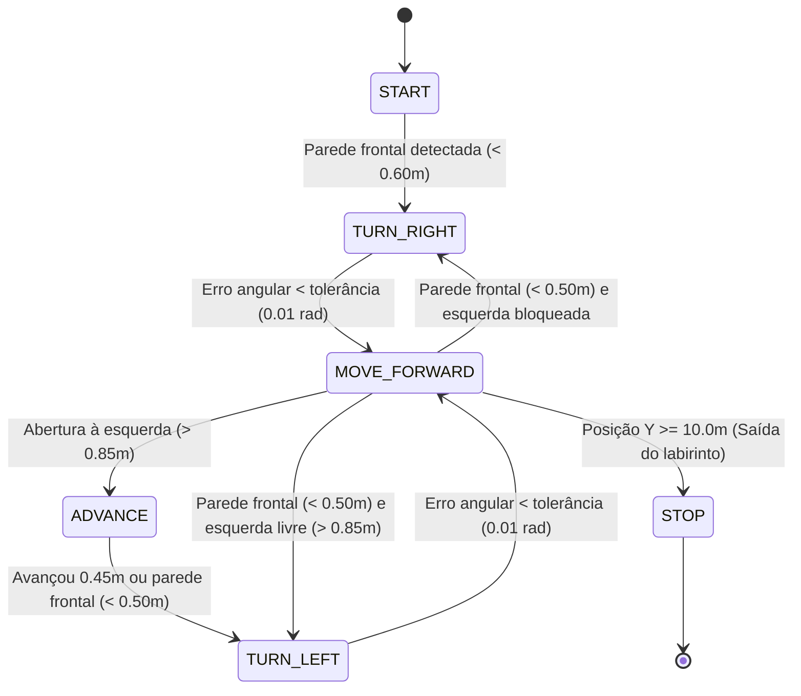

# 🤖 Navegação Autônoma em Labirinto com ROS 2 e C++ (`desafio_oxebots_julio`)

Este repositório contém a minha solução desenvolvida em **C++** e **ROS 2 (Humble)** para o **Desafio de Computação da [OxeBots](https://github.com/OxeBots)** (equipe de robótica). O objetivo do projeto é controlar autonomamente um robô móvel **TurtleBot3 Burger** no simulador **Gazebo 11** para atravessar diferentes configurações de labirintos (20m × 20m) até alcançar a saída.

> 🔗 **Contexto e Ambiente de Simulação:**  
> Este pacote foi projetado para rodar dentro do workspace oficial do desafio:  
> 👉 **[OxeBots/desafio_ws (Workspace Completo)](https://github.com/OxeBots/desafio_ws)**  
> 👉 **[OxeBots/desafio_oxebots (Pacote de Simulação e Mundos do Gazebo)](https://github.com/OxeBots/desafio_oxebots)**

---

## 🧠 Arquitetura da Solução

Para garantir que o robô consiga sair de qualquer um dos labirintos propostos (`model-1`, `model-2` e `model-3`) sem conhecer o mapa previamente, foi implementada uma **Máquina de Estados Finitos (FSM)** baseada no algoritmo *Wall Follower* (Seguidor de Parede pela Regra da Mão Esquerda), combinada com:

1. **Controle Proporcional ($K_p$) de Orientação (Yaw):**  
   A partir dos quaternions de odometria (`/odom`), o nó converte a orientação do robô para ângulos de Euler (`roll`, `pitch`, `yaw`) usando a biblioteca `tf2`. Tanto nos giros de 90° quanto durante o movimento em linha reta, um controlador proporcional corrige continuamente desvios angulares para manter o robô alinhado aos eixos dos corredores.
2. **Controle de Transição por Distância Odometricamente Medida:**  
   Em vez de depender de temporizadores fixos sujeitos a variações do *Real Time Factor* do simulador, as transições de entrada e saída de cruzamentos utilizam a distância euclidiana real percorrida (`std::hypot`), garantindo centralização nas células de 1,0 m do labirinto.

### Diagrama da Máquina de Estados (FSM)



### Descrição dos Estados

| Estado | Descrição |
| :--- | :--- |
| **`START`** | Estado inicial: avança até encontrar a primeira parede de referência e inicia o alinhamento com a parede esquerda. |
| **`MOVE_FORWARD`** | Segue em frente pelo corredor mantendo o alinhamento angular (`goal_yaw_`) com controle proporcional e monitorando aberturas à esquerda ou obstáculos à frente. |
| **`ADVANCE`** | Ao detectar uma abertura à esquerda, avança `0.45 m` pela odometria para alinhar o centro de rotação do robô com o novo corredor antes de girar. |
| **`TURN_LEFT` / `TURN_RIGHT`** | Executa giros precisos de $+90^\circ$ ou $-90^\circ$ no próprio eixo (arredondando a referência para múltiplos exatos de $\pi/2$) com controle proporcional de velocidade angular. |
| **`STOP`** | Acionado quando a coordenada $Y \ge 10.0\text{ m}$, parando o robô ao concluir o labirinto. |

---

## 📡 Tópicos ROS 2 Utilizados

| Tópico | Tipo da Mensagem | Função no Nó `robot_control` |
| :--- | :--- | :--- |
| `/scan` | `sensor_msgs/msg/LaserScan` | Leitura dos feixes do LIDAR frontal ($0^\circ$) e lateral esquerdo ($+90^\circ$). |
| `/odom` | `nav_msgs/msg/Odometry` | Posição $(x, y)$ do robô e orientação via Quaternions (convertida para `yaw`). |
| `/imu` | `sensor_msgs/msg/Imu` | Leitura de velocidade angular e aceleração linear do TurtleBot3. |
| `/cmd_vel` | `geometry_msgs/msg/Twist` | Publicação dos comandos de velocidade linear (`linear.x`) e angular (`angular.z`) a 20 Hz (`50ms`). |

---

## 🚀 Como Executar

### 1. Pré-requisitos
- **Ubuntu 22.04 LTS**
- **ROS 2 Humble**
- **Gazebo 11**

### 2. Clonar o Workspace do Desafio e Adicionar Este Pacote

Primeiro, clone o workspace oficial da OxeBots com seus submódulos:

```bash
git clone https://github.com/OxeBots/desafio_ws.git --recurse-submodules
cd desafio_ws
bash setup.sh
```

Em seguida, clone este repositório dentro da pasta `src/` do workspace:

```bash
cd src
git clone https://github.com/SEU_USUARIO/NOME_DO_SEU_REPOSITORIO.git sua_solucao
cd ..
```

### 3. Compilar o Workspace

Na raiz do `desafio_ws`, execute o script de compilação:

```bash
. build.sh
```

### 4. Rodar a Simulação e o Controlador

Em um **primeiro terminal**, inicie o ambiente de simulação no Gazebo (você pode escolher entre `model-1`, `model-2` ou `model-3`):

```bash
source install/setup.bash
ros2 launch desafio_oxebots desafio.launch.py maze_model:=model-1
```

Em um **segundo terminal**, execute o nó de controle autônomo desenvolvido neste pacote:

```bash
source install/setup.bash
ros2 run desafio_oxebots_julio robot_control
```

---

## 🛠️ Tecnologias Utilizadas

- **C++17**
- **ROS 2 Humble** (`rclcpp`, `sensor_msgs`, `nav_msgs`, `geometry_msgs`, `tf2`, `tf2_geometry_msgs`)
- **Gazebo 11** (Simulação física do TurtleBot3 Burger)
- **CMake / ament_cmake**

---

## 👤 Autor

Desenvolvido por **Julio** como projeto prático de estudo em Robótica Móvel e Sistemas Autônomos com ROS 2.
